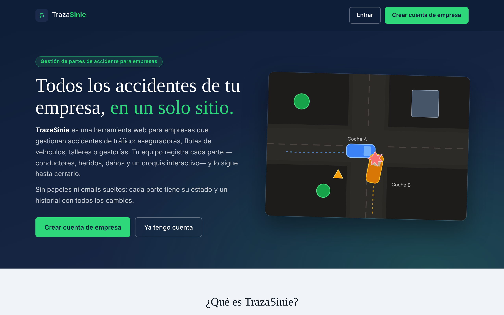
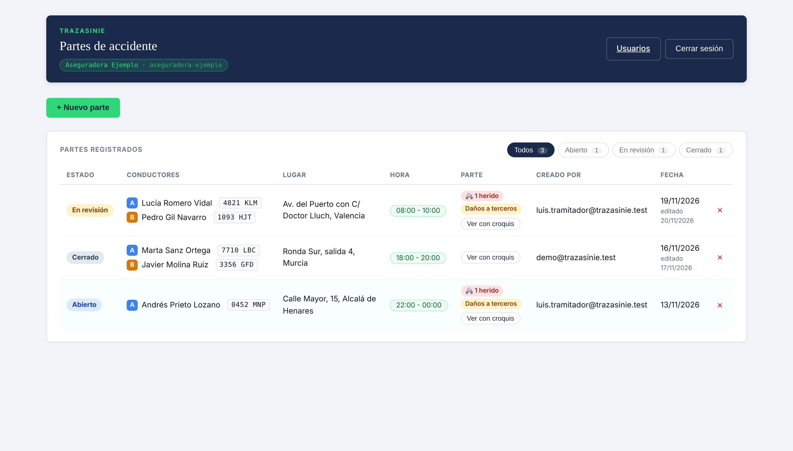
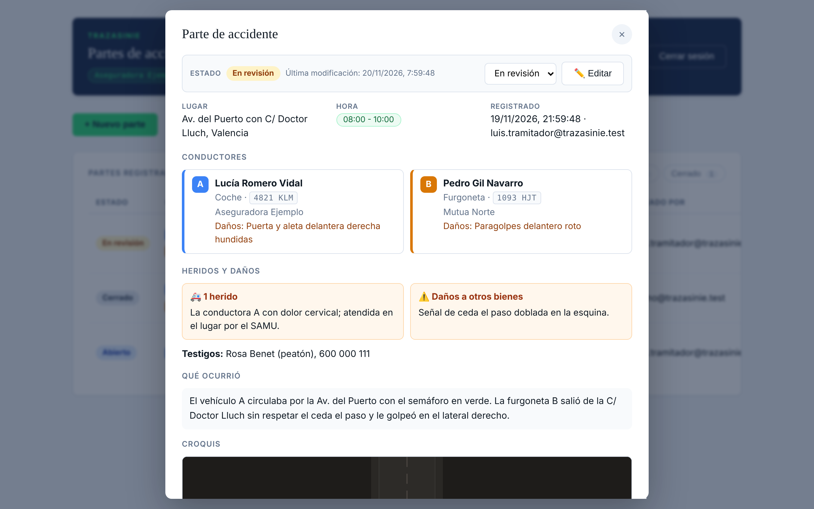
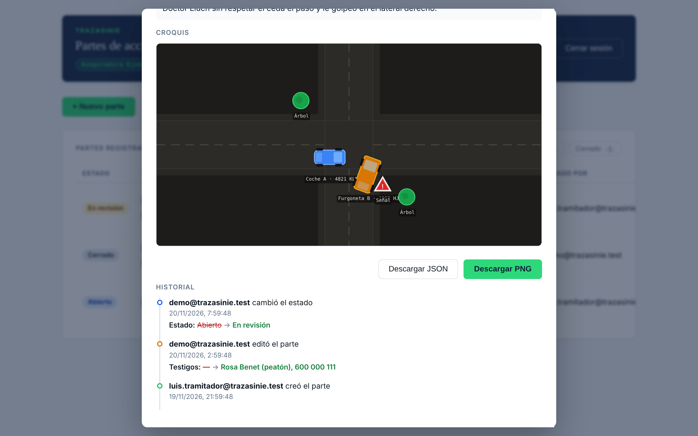
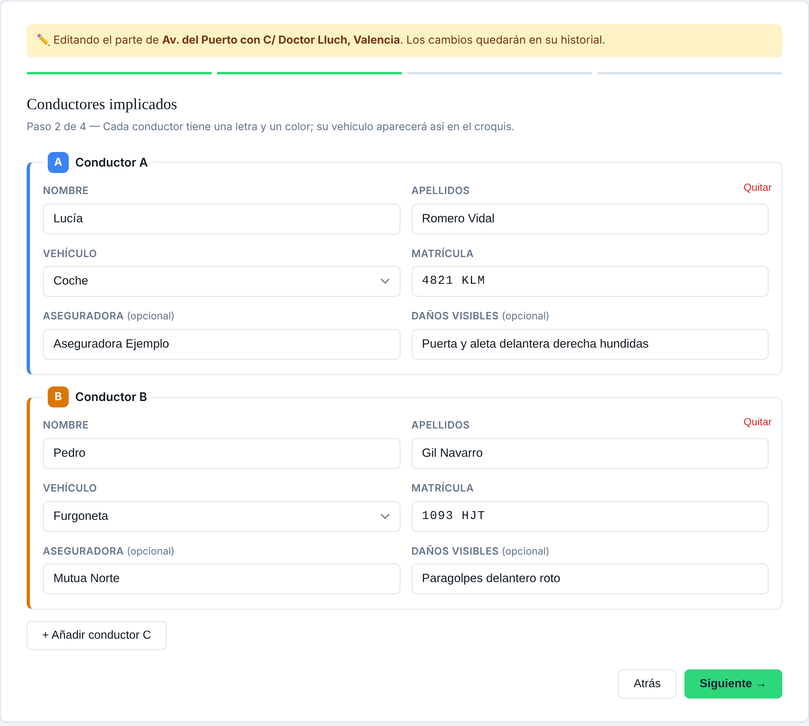
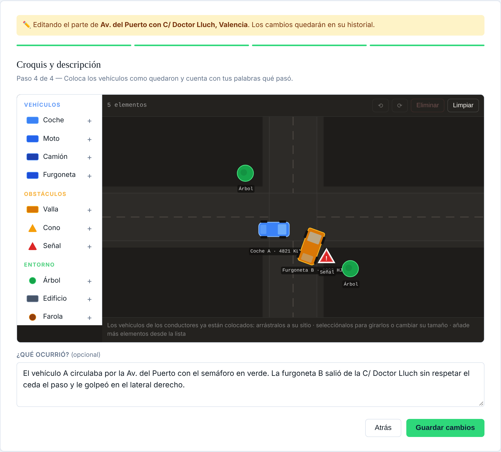
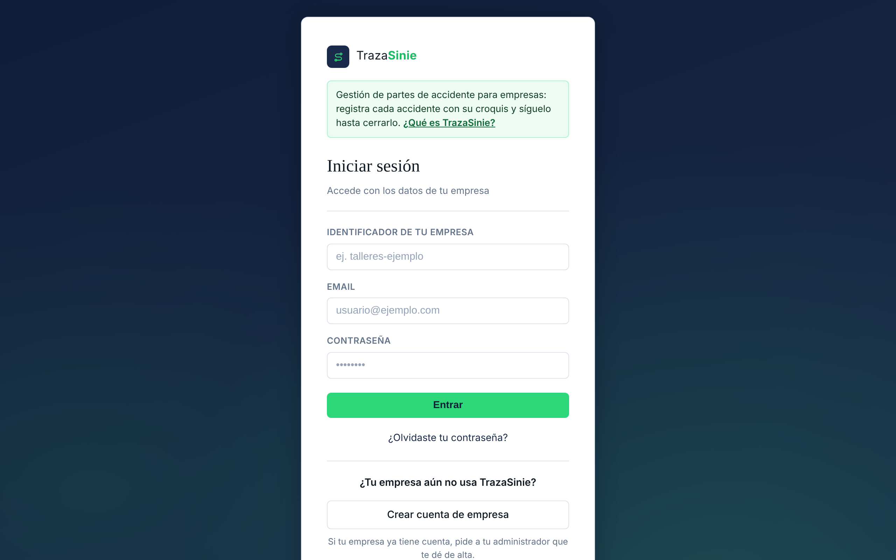
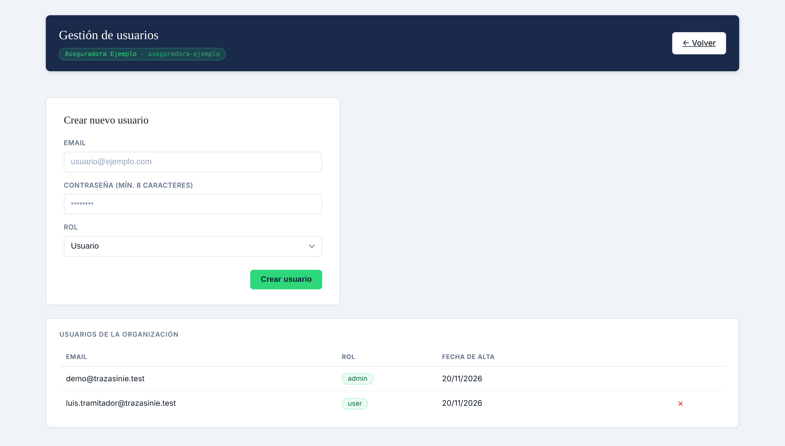

# TrazaSinie · Gestión de partes de accidente para empresas


Aplicación web **multi-empresa** (*multi-tenant*) para registrar y gestionar partes de accidente de tráfico: conductores implicados, heridos y daños, un **croquis interactivo** del accidente y el seguimiento de cada parte hasta cerrarlo, con **historial de cambios**.

> 🧪 **Prueba técnica** desarrollada por mí en un proceso de selección. El enunciado pedía una aplicación multi-tenant con inicio de sesión y un formulario en dos pasos sobre React, Express y PostgreSQL. A partir de esa base la amplié con el croquis interactivo, el formulario completo en cuatro pasos, los estados del parte, el historial de auditoría y la gestión de usuarios por roles.
>
> Todas las empresas, personas y matrículas que aparecen son **ficticias**.



## ✨ Funcionalidades

**Partes de accidente**
- **Formulario en 4 pasos**, inspirado en el parte amistoso:
  1. **Dónde y cuándo**: lugar y franja horaria.
  2. **Conductores** (de 1 a 4, con las letras A, B, C y D): nombre, vehículo, matrícula, aseguradora y daños visibles.
  3. **Heridos y daños**: número de heridos, daños a otros bienes y testigos.
  4. **Croquis y descripción** de lo ocurrido.
- **Editor de croquis interactivo** (Konva): cada vehículo aparece con la letra y el color de su conductor; los elementos se arrastran, giran y cambian de tamaño; hay obstáculos (vallas, conos, señales) y elementos del entorno (árboles, edificios, farolas).
- **Exportación** del croquis en **PNG** y del parte en **JSON**.
- **Estados**: abierto → en revisión → cerrado. Un parte cerrado no se puede editar, y solo un administrador puede reabrirlo o borrarlo.
- **Historial de auditoría**: cada alta, edición o cambio de estado queda registrado con quién lo hizo, cuándo y qué valores cambiaron (antes → después).
- **Filtro por estado** en el panel.

**Empresas y usuarios**
- **Registro de empresa**: crea la organización y su primer usuario administrador.
- **Roles**: los administradores dan de alta y de baja a su equipo; al borrar un usuario, **sus partes se conservan**.
- **Recuperación de contraseña** con enlace temporal (1 hora).

## 📸 Capturas

**Panel de partes**



**Detalle de un parte**

| Datos del parte | Croquis e historial de cambios |
|---|---|
|  |  |

**Formulario y editor de croquis**

| Paso 2 · Conductores | Paso 4 · Editor de croquis |
|---|---|
|  |  |

| Inicio de sesión | Gestión de usuarios |
|---|---|
|  |  |

## 🔒 Aislamiento entre empresas y seguridad

Cada empresa solo puede ver y tocar sus propios datos. El aislamiento se aplica en tres niveles:

1. **Token JWT firmado.** Al iniciar sesión, el token incluye el `tenantId` de la empresa, firmado por el servidor: no se puede modificar sin invalidarlo.
2. **Todas las consultas filtran por empresa**, usando siempre el `tenantId` del token y nunca uno que llegue en la petición:
   ```js
   db.query('SELECT ... FROM submissions s WHERE s.id = $1 AND s.tenant_id = $2',
            [req.params.id, req.user.tenantId]);
   ```
   Si una empresa pide un parte de otra, recibe un **404**, como si no existiera.
3. **Base de datos**: todas las tablas llevan `tenant_id` con clave foránea e índice, y `UNIQUE (tenant_id, email)` permite que el mismo email exista en empresas distintas.

Además:
- Contraseñas cifradas con **bcrypt**.
- **Consultas parametrizadas** en todo el backend (sin inyección SQL).
- **Transacciones** al guardar un parte con sus conductores y su historial, y `SELECT ... FOR UPDATE` para que dos ediciones simultáneas no se pisen.
- Validación de todos los datos en el servidor con **express-validator**, incluido el modelo del croquis (tipos, tamaños y número de elementos).
- **Helmet**, **CORS** limitado al frontend y **límite de intentos** en las rutas de autenticación.
- La recuperación de contraseña responde igual exista o no el email, para no revelar qué cuentas existen.

## 🚀 Cómo ejecutarlo en local

**Requisitos:** [Node.js](https://nodejs.org/) 18+ y [PostgreSQL](https://www.postgresql.org/) 14+.

```bash
git clone https://github.com/corderocana-dev/trazasinie.git
cd trazasinie
npm run instalar
```

1. Copia `backend/.env.example` como `backend/.env` y pon tu usuario y contraseña de PostgreSQL en `DATABASE_URL`, y una clave larga y aleatoria en `JWT_SECRET`.
2. Crea la base de datos y sus tablas, y carga los datos de ejemplo:
   ```bash
   npm run db:crear
   npm run db:ejemplo
   ```
3. Arranca el backend y el frontend a la vez:
   ```bash
   npm run dev
   ```
   La aplicación se abre en `http://localhost:5173` y la API escucha en `http://localhost:3001`.

**Cuentas de prueba** (creadas con `npm run db:ejemplo`; contraseña de todas: `DemoTraza2026`):

| Empresa (identificador) | Email | Rol |
|---|---|---|
| `aseguradora-ejemplo` | `demo@trazasinie.test` | Administrador |
| `aseguradora-ejemplo` | `luis.tramitador@trazasinie.test` | Usuario |
| `mutua-norte` | `admin@mutuanorte.test` | Administrador |

Entrando con **Mutua Norte** se puede comprobar el aislamiento: no aparece ningún parte de Aseguradora Ejemplo.

## 🗂️ Modelo de datos

```
tenants           Empresas (id, slug, nombre)
 ├─ users         Empleados de la empresa (email, contraseña cifrada, rol)
 └─ submissions   Partes de accidente (lugar, hora, heridos, daños, croquis, estado…)
     ├─ conductores       Conductores A–D de cada parte (vehículo, matrícula, aseguradora, daños)
     └─ parte_historial   Auditoría: quién, cuándo y qué cambió (antes → después)
```

El esquema completo está en [`schema.sql`](schema.sql). Se puede ejecutar varias veces: solo crea lo que falta y actualiza las bases de datos antiguas sin perder datos.

## 🔌 API

| Método | Ruta | Acceso | Descripción |
|---|---|---|---|
| POST | `/api/auth/register` | Público | Crea la empresa y su administrador |
| POST | `/api/auth/login` | Público | Inicia sesión y devuelve el token JWT |
| POST | `/api/auth/recuperar-contrasena` | Público | Genera un enlace de recuperación |
| POST | `/api/auth/reset-contrasena` | Público | Cambia la contraseña con el enlace |
| GET | `/api/submissions` | Usuario | Lista los partes de la empresa |
| GET | `/api/submissions/:id` | Usuario | Parte completo, con conductores y croquis |
| GET | `/api/submissions/:id/historial` | Usuario | Historial de cambios del parte |
| POST | `/api/submissions` | Usuario | Crea un parte |
| PUT | `/api/submissions/:id` | Usuario | Edita un parte (no si está cerrado) |
| PATCH | `/api/submissions/:id/estado` | Usuario | Cambia el estado (reabrir: solo admin) |
| DELETE | `/api/submissions/:id` | Usuario | Borra un parte (cerrado: solo admin) |
| GET | `/api/submissions/meta/horas` | Usuario | Franjas horarias válidas |
| GET / POST | `/api/usuarios` | Admin | Lista y crea usuarios de la empresa |
| DELETE | `/api/usuarios/:id` | Admin | Borra un usuario (sus partes se conservan) |

## 📁 Estructura

```
trazasinie/
├── schema.sql                  # Esquema de PostgreSQL
├── scripts/dev.js              # Arranca backend y frontend con un solo comando
├── backend/
│   ├── scripts/                # Crear la base de datos y cargar datos de ejemplo
│   └── src/
│       ├── app.js              # Express, seguridad y rutas
│       ├── config/db.js        # Pool de conexiones a PostgreSQL
│       ├── middleware/auth.js  # Verificación del JWT y control de roles
│       └── routes/             # auth, partes (submissions) y usuarios
└── frontend/
    └── src/
        ├── pages/              # Portada, login, registro, panel, usuarios…
        ├── components/
        │   ├── FormularioParte/  # Los 4 pasos del formulario
        │   ├── Croquis/          # Editor y visor del croquis (Konva)
        │   └── DetalleParte.jsx  # Detalle, estado e historial
        ├── context/AuthContext.jsx
        └── services/api.js     # Axios con el token JWT
```

## 🔜 Mejoras pendientes

- **Enviar por email** el enlace de recuperación de contraseña. Ahora se genera y se muestra en la consola del servidor; en producción habría que conectar un servicio como SendGrid o Resend.
- **Tests automáticos** de la API, sobre todo del aislamiento entre empresas.
- **Despliegue** del frontend, la API y la base de datos.

## 👤 Autor

**Antonio Cordero Caña** · [GitHub](https://github.com/corderocana)
